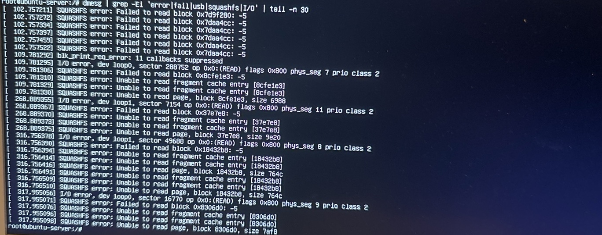
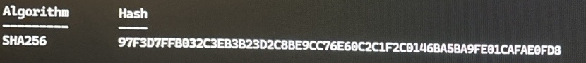
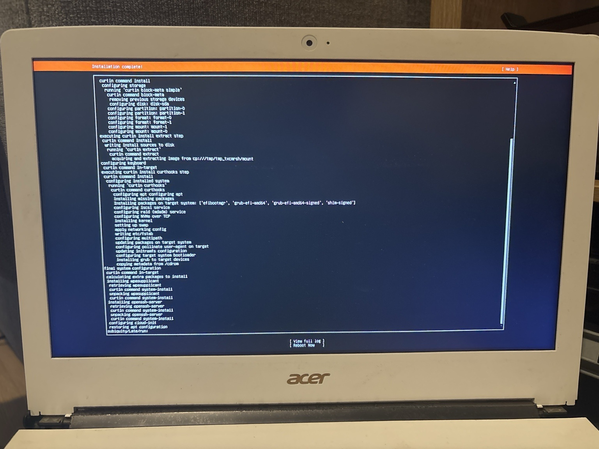
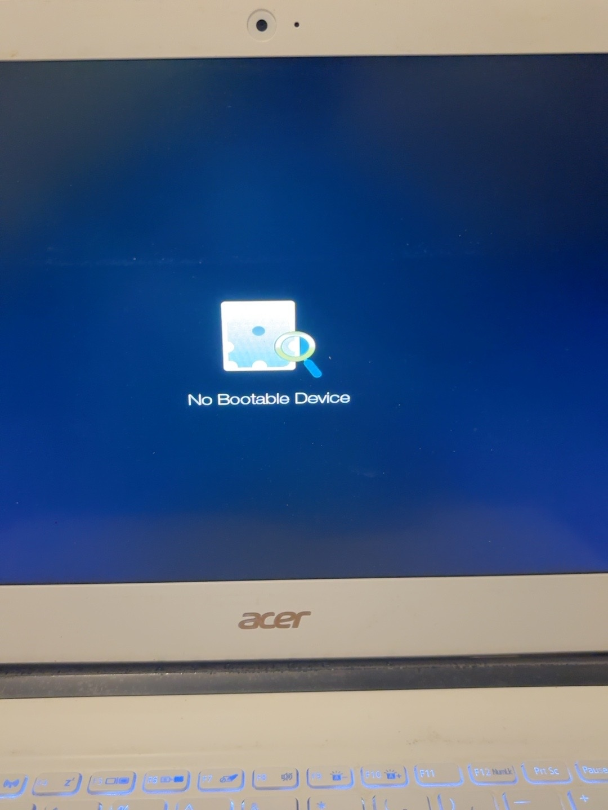
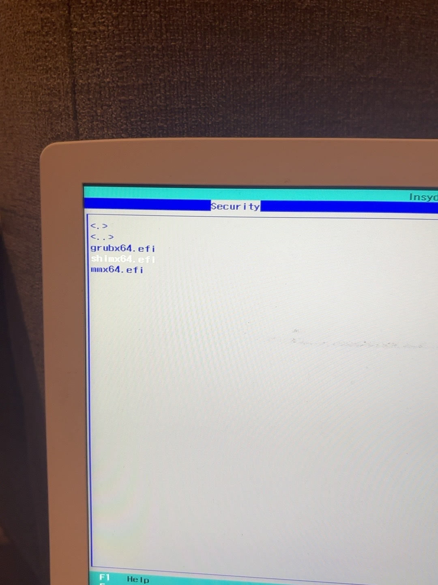
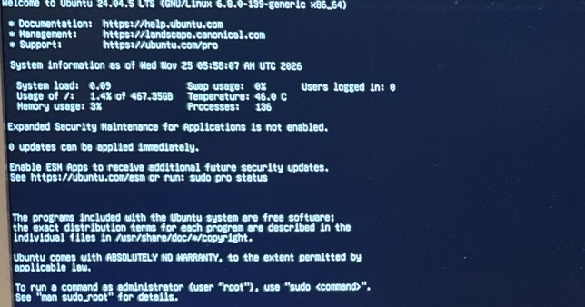

# Day 3: Physical Server Installation and Troubleshooting

**Date:** 25 November 2026  
**Phase:** Physical Server Deployment  
**Status:** Completed

## 1. Objective

Repurpose an Acer laptop into a dedicated Ubuntu Server to establish the foundation for a self-hosted family media server.

Develop practical skills in Linux installation, hardware troubleshooting, storage configuration and UEFI boot management.

## 2. Environment

| Component | Specification |
|---|---|
| Laptop | Acer Aspire S5-371T |
| Processor | Intel Core i7-6500U |
| Memory | 8GB RAM |
| Storage | Samsung 512GB SSD |
| Operating System | Ubuntu Server 24.04.5 LTS |
| Hostname | media-server |
| Firmware | UEFI |
| Secure Boot | Enabled |
| Installation Media | Verbatim 8GB USB |
| Installation Tool | Rufus 4.16 |
| Network Configuration | Offline |

## 3. Tasks Performed

- Investigated repeated Ubuntu Server installation failures.
- Examined Linux kernel logs and storage devices.
- Verified the replacement ISO using a SHA256 checksum.
- Created replacement installation media using Rufus.
- Installed Ubuntu Server on the internal SSD.
- Configured ext4 and EFI partitions.
- Created a local administrative account.
- Installed OpenSSH Server.
- Manually registered the Ubuntu EFI bootloader.
- Verified successful login and automatic boot.

## 4. Troubleshooting

### Issue 1: Installation Media Failure

The Ubuntu Server installer repeatedly crashed during configuration.

Kernel logs revealed SQUASHFS and input/output errors, indicating difficulties reading the installation files.

*Figure 1: SQUASHFS and input/output errors identified through Linux kernel logs.*

### Resolution

- Verified the replacement Ubuntu Server ISO using SHA256.
- Replaced the original USB with a Verbatim 8GB USB.
- Selected DD Image mode in Rufus.
- Used Ubuntu Server 24.04.5 LTS.
- Repeated the installation process.

*Figure 2: ISO integrity verification using Windows PowerShell.*

The replacement installation completed successfully. Since multiple variables were changed, the exact cause of the original failure was not isolated.

*Figure 3: Successful completion of Ubuntu Server installation.*

### Issue 2: No Bootable Device

After installation, the laptop displayed a No Bootable Device error.

*Figure 4: UEFI boot failure following successful installation.*

The BIOS detected the internal Samsung SSD but did not recognise Ubuntu as a bootable operating system.

### Resolution

- Accessed the Acer UEFI firmware settings.
- Confirmed the internal SSD was detected.
- Verified UEFI mode and Secure Boot were enabled.
- Configured a BIOS supervisor password.
- Located the Ubuntu EFI bootloader.
- Registered the signed EFI executable as trusted.

Bootloader path:

`EFI/ubuntu/shimx64.efi`

*Figure 5: Locating Ubuntu's signed EFI bootloader.*

- Saved the firmware configuration.
- Restarted the laptop.
- Selected Ubuntu from the boot menu.
- Verified successful startup from the internal SSD.
- Performed an additional reboot to confirm automatic boot.

Secure Boot remained enabled throughout the troubleshooting process.

## 5. Verification and Results

| Verification | Result |
|---|---|
| ISO integrity | Passed |
| Ubuntu Server installation | Successful |
| Internal SSD detection | Successful |
| EFI bootloader registration | Successful |
| Secure Boot | Enabled |
| Local authentication | Successful |
| Automatic boot | Successful |
| OpenSSH installation | Completed |
| Network connectivity | Pending |

*Figure 6: Successful authentication into the physical Ubuntu Server.*

### Initial System Information

| Metric | Result |
|---|---|
| Memory Usage | 3% |
| Storage Usage | 1.4% |
| System Temperature | 46°C |
| CPU Architecture | x86_64 |

## 6. Commands Learned

| Command | Purpose |
|---|---|
| `lsblk -f` | Display storage devices and file systems |
| `dmesg` | Examine Linux kernel messages |
| `grep` | Filter terminal output |
| `tail -n 30` | Display the final 30 lines of output |
| `Get-FileHash` | Generate a file checksum in PowerShell |
| `sudo reboot` | Safely restart the server |
| `sudo poweroff` | Safely shut down the server |

## 7. Challenges and Lessons Learned

- Kernel logs help identify installation and hardware-related errors.
- SHA256 checksums provide a method of verifying file integrity.
- Alternative installation media can help troubleshoot read failures.
- Successful installation does not guarantee successful system boot.
- UEFI firmware may require manual bootloader registration.
- Secure Boot can remain enabled when using Ubuntu's signed bootloader.
- Rebooting after configuration changes helps verify system functionality.

This session involved AI-assisted troubleshooting. I performed the installation, executed commands, inspected results and verified the configuration on physical hardware.

## 8. Outcome

Successfully deployed Ubuntu Server on a repurposed Acer laptop.

Resolved installation media errors and a UEFI bootloader registration issue without replacing the internal SSD or disabling Secure Boot.

The physical server now boots independently without installation media and provides the foundation for the family media server project.

## 9. Next Steps

- [ ] Connect and configure Ethernet.
- [ ] Identify the server's IP address.
- [ ] Install system and security updates.
- [ ] Establish remote SSH access.
- [ ] Configure SSH key authentication.
- [ ] Configure headless server operation.
- [ ] Deploy media server software.
- [ ] Configure remote access using Tailscale.
