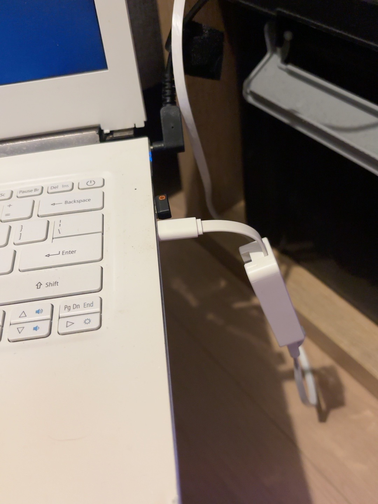
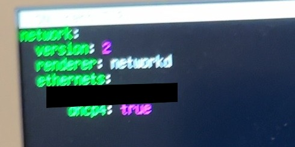
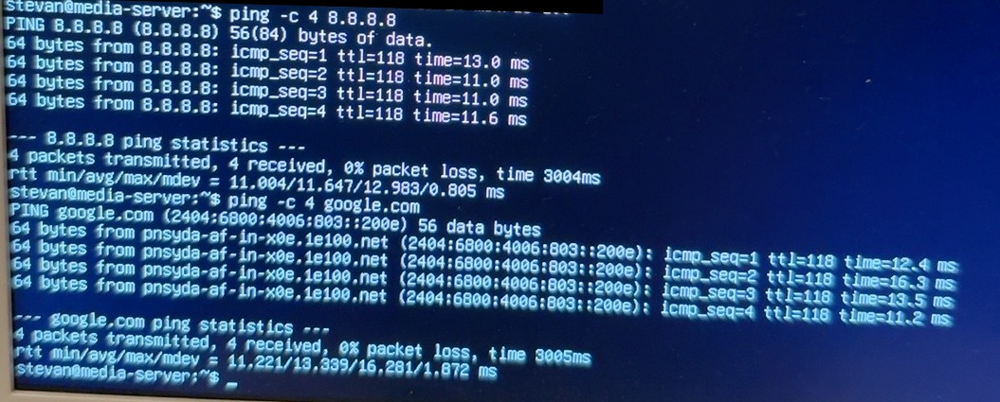
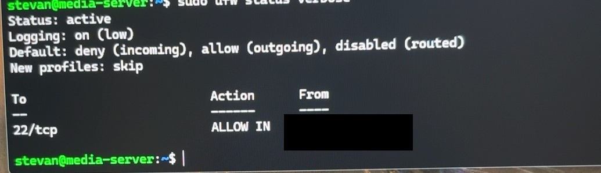
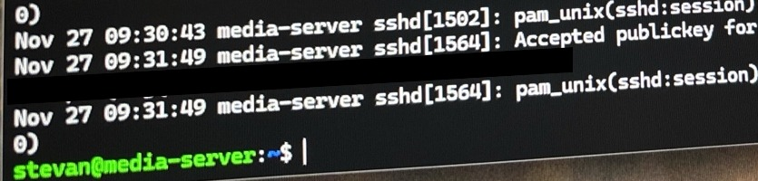
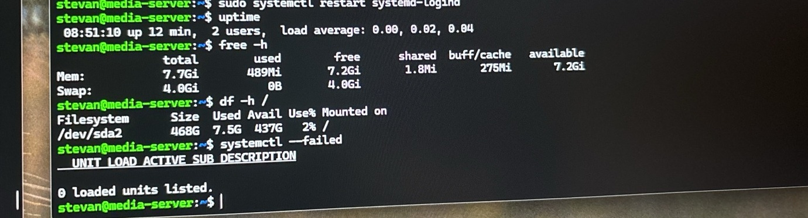

# Day 4: Network Configuration and Server Hardening

**Date:** 27 November 2026  
**Phase:** Network Configuration and Security  
**Status:** Completed

## 1. Objective

Establish persistent wired network connectivity, configure secure remote administration and prepare the physical Ubuntu Server for headless operation.

Develop practical skills in Linux networking, DHCP, SSH authentication, firewall management and system maintenance.

## 2. Environment

| Component | Specification |
|---|---|
| Laptop | Acer Aspire S5-371T |
| Processor | Intel Core i7-6500U |
| Memory | 8GB RAM |
| Storage | Samsung 512GB SSD |
| Operating System | Ubuntu Server 24.04.5 LTS |
| Hostname | media-server |
| Network Adapter | USB-C Gigabit Ethernet Adapter |
| Network Switch | Gigabit Ethernet Switch |
| Network Cabling | Cat6 Ethernet |
| Address Assignment | DHCP |
| Administration Device | Windows Desktop |
| Remote Administration | OpenSSH |
| Firewall | UFW |
| Authentication | ED25519 SSH Key |

## 3. Tasks Performed

- Connected the server to the physical Ethernet network.
- Identified and activated the Ethernet interface.
- Created a persistent Netplan configuration.
- Configured IPv4 address assignment through DHCP.
- Verified IPv4, IPv6, DNS and routing.
- Established SSH access from Windows PowerShell.
- Installed system and security updates.
- Verified connectivity following a system reboot.
- Enabled and configured the UFW firewall.
- Configured lid-closed server operation.
- Performed system health checks.
- Generated an ED25519 SSH key pair.
- Configured public key authentication.
- Disabled SSH password authentication.
- Disabled direct root login.
- Investigated DHCP reservation requirements.



*Figure 1: USB-C Ethernet adapter connected to the physical Ubuntu Server.*

## 4. Troubleshooting

### Issue 1: Inactive Ethernet Interface

Ubuntu detected the USB-C Ethernet adapter, but the interface was inactive and had no assigned IPv4 address.

### Resolution

- Identified the Ethernet interface using Linux networking commands.
- Manually activated the interface.
- Created a persistent Netplan configuration.
- Enabled DHCP for automatic IPv4 address assignment.
- Validated and applied the network configuration.



*Figure 2: Persistent Ethernet configuration using Netplan.*

The router successfully assigned a private IPv4 address to the server.

### Issue 2: Initial SSH Connection Closed

The initial SSH connection closed after verifying the server's ED25519 host fingerprint.

### Resolution

- Confirmed the server fingerprint matched the Windows SSH client.
- Repeated the SSH connection from Windows PowerShell.
- Successfully authenticated using the local Ubuntu account.


*Figure 3: Successful remote administration from Windows PowerShell.*

### Issue 3: Laptop Lid Suspension

The Acer laptop required power management configuration before operating as a headless server.

### Resolution

Modified the systemd-logind configuration:

`/etc/systemd/logind.conf`

Configured the following settings:

```ini
HandleLidSwitch=ignore
HandleLidSwitchExternalPower=ignore
HandleLidSwitchDocked=ignore
```

- Restarted the systemd-logind service.
- Configured the server to remain operational with the lid closed.
- Verified continued server responsiveness through SSH.


*Figure 4: Verifying server uptime through SSH following the power management changes.*

### Issue 4: SSH Password Authentication Conflict

After disabling SSH password authentication, the effective OpenSSH configuration continued to report password authentication as enabled.

An additional cloud-init configuration file contained a conflicting setting:

`/etc/ssh/sshd_config.d/50-cloud-init.conf`

### Resolution

- Inspected the effective OpenSSH configuration.
- Identified the conflicting cloud-init setting.
- Created a local SSH configuration override.
- Validated the updated configuration.
- Reloaded the SSH service.
- Established a new SSH connection using the ED25519 key.

Password authentication was successfully disabled while public key authentication remained available.

### Issue 5: Router Administrator Access

The router administrator credentials were unavailable, preventing DHCP reservation configuration.

### Resolution

- Identified the Telstra Smart Modem Gen 2.
- Contacted Telstra for assistance.
- Investigated administrator password recovery options.
- Deferred DHCP reservation to avoid disrupting the household network through a factory reset.

Dynamic DHCP address assignment remains operational.

## 5. Verification and Results

| Verification | Result |
|---|---|
| Ethernet adapter detection | Successful |
| Gigabit Ethernet link | 1,000 Mbps |
| Persistent network configuration | Successful |
| DHCP address assignment | Successful |
| IPv4 connectivity | Passed |
| IPv6 connectivity | Passed |
| DNS resolution | Passed |
| Routing configuration | Verified |
| SSH remote administration | Successful |
| System updates | Completed |
| Reboot verification | Passed |
| UFW firewall | Active |
| Headless configuration | Completed |
| SSH key authentication | Successful |
| Password authentication | Disabled |
| Direct root login | Disabled |
| DHCP reservation | Pending |



*Figure 5: Successful IPv4 and IPv6 connectivity tests with zero packet loss.*

### Network Performance

| Metric | Result |
|---|---|
| Negotiated Ethernet Link Speed | 1 Gbps |
| IPv4 Packet Loss | 0% |
| IPv6 Packet Loss | 0% |
| Average IPv4 Latency | 11.65 ms |
| Average IPv6 Latency | 13.39 ms |

### System Updates

| Component | Before | After |
|---|---|---|
| Linux Kernel | 6.8.0-139 | 6.8.0-151 |
| Available Package Updates | 126 | 0 |

Ethernet connectivity and SSH access remained operational following the system reboot.

### Firewall Verification

| Setting | Policy |
|---|---|
| Firewall Status | Active |
| Default Incoming Traffic | Deny |
| Default Outgoing Traffic | Allow |
| SSH Access | Local IPv4 Subnet |
| SSH Port | TCP 22 |
| Automatic Startup | Enabled |



*Figure 6: Active UFW firewall with restricted local SSH access.*

### SSH Security Verification

| Setting | Result |
|---|---|
| Public Key Authentication | Enabled |
| Password Authentication | Disabled |
| Keyboard-Interactive Authentication | Disabled |
| Direct Root Login | Disabled |
| SSH Key Algorithm | ED25519 |
| Authentication Log | Accepted Public Key |



*Figure 7: Successful public key authentication recorded in the SSH service logs.*


*Figure 8: Verified OpenSSH authentication and security settings.*

### System Health

| Metric | Result |
|---|---|
| Total Usable Memory | 7.7 GiB |
| Memory Used | 489 MiB |
| Available Memory | 7.2 GiB |
| Available Storage | 437 GiB |
| Storage Usage | 2% |
| Swap Usage | 0% |
| Failed System Services | 0 |



*Figure 9: Server memory, storage and system service health checks.*

## 6. Commands Learned

| Command | Purpose |
|---|---|
| `ip -br address` | Display network interfaces and assigned addresses |
| `ip link set` | Change network interface state |
| `ip -4 -br address` | Display IPv4 addresses |
| `ip route` | Display the routing table |
| `ping -c 4` | Test network connectivity |
| `sudo netplan generate` | Validate network configuration |
| `sudo netplan apply` | Apply network configuration |
| `sudo chmod 600` | Restrict file permissions |
| `systemctl status ssh.socket` | Inspect SSH socket status |
| `ssh` | Establish a remote SSH connection |
| `sudo apt update` | Refresh package information |
| `sudo apt upgrade` | Install package updates |
| `uname -r` | Display the running kernel version |
| `sudo ufw status verbose` | Inspect firewall configuration |
| `sudo ufw enable` | Activate the firewall |
| `uptime` | Display server uptime and system load |
| `free -h` | Display memory usage |
| `df -h /` | Display root filesystem usage |
| `systemctl --failed` | Identify failed system services |
| `ssh-keygen` | Generate an SSH key pair |
| `journalctl` | Inspect system and service logs |
| `sudo sshd -t` | Validate SSH configuration |
| `sudo sshd -T` | Display effective SSH configuration |
| `sudo systemctl reload ssh` | Reload SSH configuration |

## 7. Challenges and Lessons Learned

- Network interfaces require activation and valid IP configuration.
- DHCP automatically assigns network addressing information.
- YAML indentation determines configuration hierarchy.
- Routing tables identify network paths and default gateways.
- IPv4 and IPv6 provide different methods of network addressing.
- SSH host fingerprints provide server identity verification.
- Public key authentication reduces reliance on passwords.
- Firewall rules should preserve authorised administrative access.
- Configuration precedence can affect effective service settings.
- System logs provide evidence of successful authentication.
- Reboot testing helps verify persistent configuration.
- DHCP reservation differs from dynamic DHCP address assignment.

This session involved AI-assisted configuration and troubleshooting. I executed commands, configured network and security settings, inspected results and verified functionality on physical hardware.

## 8. Outcome

Successfully established a networked, headless Ubuntu Server with gigabit Ethernet connectivity and secure local SSH administration.

Implemented firewall protection, installed system updates and configured ED25519 public key authentication.

The server provides a foundation for deploying the family media server software.

## 9. Next Steps

- [x] Connect and configure Ethernet.
- [x] Identify the server's IP address.
- [x] Install system and security updates.
- [x] Establish remote SSH access.
- [x] Configure SSH key authentication.
- [x] Configure headless server operation.
- [ ] Configure DHCP reservation.
- [ ] Review available firmware updates.
- [ ] Install and configure Jellyfin.
- [ ] Configure media libraries.
- [ ] Configure remote access using Tailscale.
- [ ] Establish backup procedures.
