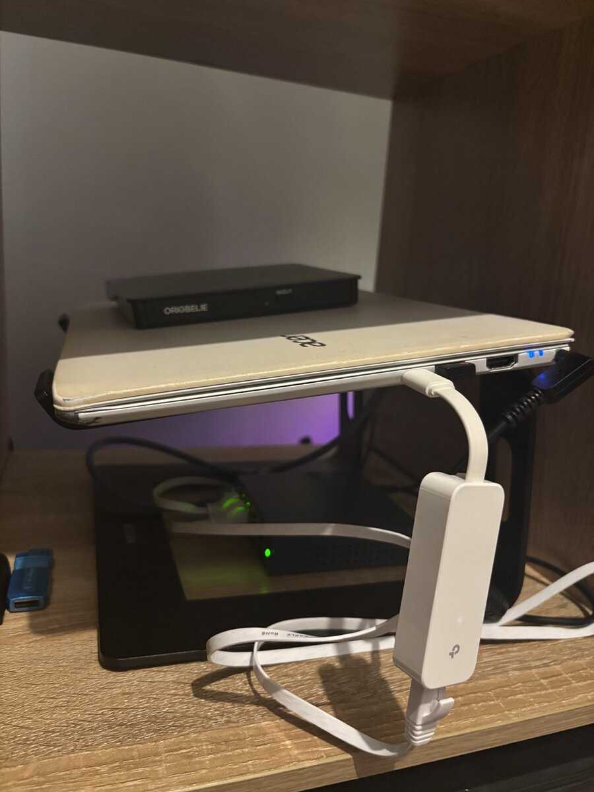

# Day 5: Jellyfin Deployment and Secure Remote Access

**Date:** 28 November 2026  
**Project:** Home Lab Journey  
**Phase:** Self-Hosted Media Server  
**Status:** Completed

## 1. Objective

Deploy a self-hosted family media server, organise personal media, configure standard user accounts and validate local and remote streaming.

## 2. Environment

| Component | Specification |
|---|---|
| Laptop | Acer Aspire S5-371T |
| Processor | Intel Core i7-6500U |
| CPU Cores | 2 |
| CPU Threads | 4 |
| Memory | 8 GB RAM |
| Storage | Samsung 512 GB SSD |
| Operating System | Ubuntu Server 24.04.5 LTS |
| External Optical Drive | ORIGBELIE BT524 |
| Optical Drive Interface | USB-A (USB 3.0) |
| Optical Drive Use | Audio CD reading and extraction |
| Network | Gigabit Ethernet |
| Media Software | Jellyfin |
| Private Networking | Tailscale |
| Audio Format | FLAC |
| Clients | Windows and iOS |

### Physical Setup

The ORIGBELIE BT524 external USB optical drive is used to import audio CDs into the FLAC music library.

## 3. Tasks Performed

- Verified server connectivity and system health.
- Reviewed and applied an available Secure Boot database update.
- Verified successful reboot and service health.
- Downloaded Jellyfin and verified the installation script checksum.
- Installed and configured the media server.
- Reviewed firewall protection and media directory permissions.
- Configured music and family video libraries.
- Connected and tested an external USB optical drive.
- Imported two CDs into lossless FLAC files.
- Configured and tested a standard family account.
- Tested lid-closed operation and monitored resource usage.
- Established private remote access using Tailscale.
- Verified streaming over mobile data in the browser and mobile application.

## 4. Troubleshooting

### Issue 1: Firmware Update Pending Reboot

The firmware update command was accidentally suspended.

### Resolution

Resumed the command, inspected the update history and rebooted the server after confirming the update status. Verified successful installation and zero failed services.

### Issue 2: Music Library Initially Empty

The audio files were present, but Jellyfin had not indexed the first album.

### Resolution

Verified file presence and permissions, triggered a manual library scan and confirmed successful playback.

### Issue 3: Compilation Track Metadata

The second CD required manual metadata entry. An omitted track title caused twelve track labels to be incorrect.

### Resolution

Compared the filenames and embedded tags against the original CD, corrected the affected artist and title tags using metaflac, renamed the files and verified the track order. No audio re-encoding was necessary.

### Issue 4: Compilation Album Grouping

The compilation did not initially display the individual songs correctly.

### Resolution

Identified missing album artist metadata, assigned a consistent compilation album artist and rescanned the library. Verified all fifteen song titles and artists.

### Issue 5: Mobile App Connectivity

The application initially retained the local server address when switching to mobile data.

### Resolution

Updated the application's server connection for private remote access and confirmed playback over 5G.

## 5. Verification and Results

| Verification | Result |
|---|---|
| System updates | Up to date |
| Secure Boot database update | Successful |
| Failed system services after reboot | 0 |
| Jellyfin deployment | Successful |
| Desktop playback | Passed |
| Mobile playback on home network | Passed |
| Standard user playback | Passed |
| Administrator dashboard restriction | Passed |
| Headless operation | Passed |
| Remote playback over 5G | Passed |
| Albums imported | 2 |
| FLAC tracks imported | 31 |
| Compilation metadata | Verified |

### System Performance

| Metric | Lid Open | Lid Closed |
|---|---:|---:|
| CPU idle | 99.4% | 99.7% |
| Jellyfin resident memory | 387 MiB | 386 MiB |
| Swap usage | 0 MiB | 0 MiB |

CPU package temperature measured 33°C during the lid-closed test. These measurements represent a light music streaming workload.

### Security Concepts Applied

- Least-privilege user access.
- Firewall management.
- Software integrity verification.
- Secure Boot maintenance.
- Encrypted private networking.

Network addresses, account identifiers, credentials and detailed access policies are excluded from this public documentation.

## 6. Commands Learned

| Command | Purpose |
|---|---|
| `apt update` | Refresh package information |
| `fwupdmgr` | Manage firmware updates |
| `sha256sum` | Verify file integrity |
| `systemctl` | Inspect system services |
| `lsblk` | Identify storage devices |
| `cdparanoia` | Inspect audio CDs |
| `abcde` | Import CD audio |
| `metaflac` | Edit FLAC metadata |
| `nano` | Edit text files |
| `find` | Locate files |
| `du` | Inspect storage usage |
| `top` | Monitor resource usage |
| `sensors` | Inspect hardware temperatures |

## 7. Challenges and Lessons Learned

- Verify firmware updates following a reboot.
- Confirm software integrity before installation.
- Distinguish embedded media tags from filenames.
- Use consistent album artist tags for compilations.
- Review resource usage before restarting a service.
- Test application permissions using separate user accounts.
- Verify services across different client devices and networks.

This session involved AI-assisted guidance and independent practical troubleshooting. I executed commands, corrected metadata, configured services and verified results on physical hardware.

## 8. Outcome

Successfully deployed a functioning family media server using repurposed hardware. Verified local and remote music playback, standard account access and headless operation. Imported 31 FLAC tracks and resolved compilation metadata issues.

## 9. Next Steps

- [x] Complete firmware maintenance.
- [x] Deploy Jellyfin.
- [x] Configure media libraries.
- [x] Verify local media playback.
- [x] Test standard user accounts.
- [x] Verify private remote streaming.
- [ ] Verify service persistence and restart recovery.
- [ ] Review access policies.
- [ ] Configure HTTPS.
- [ ] Establish backups.
- [x] Add privacy-reviewed setup photographs.
- [ ] Develop Python maintenance automation.
