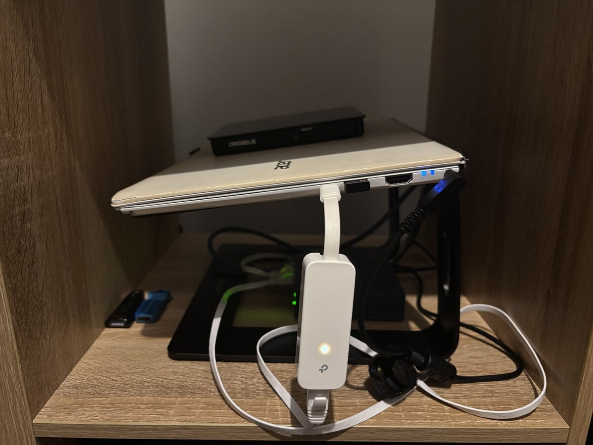

# Home Lab Journey

## Project Overview

This repository documents my journey from building a virtual home lab to developing dedicated physical IT infrastructure.

My goal is to develop practical technical skills in preparation for a Bachelor of Information and Communications Technology, majoring in Networking and Cloud Computing.

The current project focuses on deploying a self-hosted family media server using repurposed hardware, Linux, secure networking and remote administration.

## Current Server Setup

The Acer laptop operates with its lid closed, using a wired Gigabit Ethernet connection and an external USB optical drive for CD imports.

## Learning Objectives

- Linux administration
- Computer networking
- Virtualisation
- Server administration
- Python automation
- Cybersecurity
- Cloud computing
- Infrastructure troubleshooting
- Technical documentation

## Current Hardware

### Desktop Workstation

| Component | Specification |
|---|---|
| Processor | AMD Ryzen 7 9800X3D |
| CPU Cores | 8 |
| CPU Threads | 16 |
| RAM | 32 GB |
| Storage | 2 NVMe SSDs |
| Host OS | Windows 11 |
| Virtualisation | Enabled |

### Physical Server

| Component | Specification |
|---|---|
| Laptop | Acer Aspire S5-371T |
| Processor | Intel Core i7-6500U |
| CPU Cores | 2 |
| CPU Threads | 4 |
| RAM | 8 GB |
| Storage | Samsung 512 GB SSD |
| Operating System | Ubuntu Server 24.04.5 LTS |
| Hostname | media-server |
| Firmware | UEFI |
| Secure Boot | Enabled |

### Networking Equipment

| Component | Specification |
|---|---|
| Network Switch | TP-Link TL-SG105 |
| Switch Type | Unmanaged |
| Ethernet Ports | 5 |
| Port Speed | 10/100/1000 Mbps |
| Network Adapter | TP-Link UE300C |
| Adapter Interface | USB-C to Gigabit Ethernet |
| Network Cabling | Cat6 Ethernet |
| Negotiated Link Speed | 1 Gbps |
| IPv4 Address Assignment | DHCP with reservation |
| Remote Administration | OpenSSH |

## Project Roadmap

- [x] Phase 1: Virtual Home Lab
- [x] Phase 2: Physical Server Installation
- [x] Phase 3: Networking Infrastructure
- [x] Phase 4: Local Remote Server Administration
- [x] Phase 5: Initial Security Hardening
- [x] Phase 6: Headless Server Configuration
- [x] Phase 7: Self-Hosted Media Server
- [x] Phase 8: Secure Remote Access with Tailscale
- [ ] Phase 9: Python Automation
- [ ] Phase 10: Cloud Infrastructure

## Project Documentation

### 01 - Virtualisation

| Session | Documentation | Status |
|---|---|---|
| Day 1 | [Ubuntu Server Installation](01-Virtualisation/Day-001-Ubuntu-Server-Installation.md) | Completed |
| Day 2 | [Ubuntu Server Maintenance](01-Virtualisation/Day-002-Ubuntu-Server-Maintenance.md) | Completed |

### 02 - Physical Server Deployment

| Session | Documentation | Status |
|---|---|---|
| Day 3 | [Physical Server Installation and Troubleshooting](02-Physical-Server-Deployment/Day-003-Physical-Server-Installation.md) | Completed |

### 03 - Network Configuration

| Session | Documentation | Status |
|---|---|---|
| Day 4 | [Network Configuration and Server Hardening](03-Network-Configuration/Day-004-Network-Configuration-and-Server-Hardening.md) | Completed |

### 04 - Media Server Deployment

| Session | Documentation | Status |
|---|---|---|
| Day 5 | [Jellyfin Deployment and Secure Remote Access](04-Media-Server-Deployment/Day-005-Jellyfin-Deployment-and-Secure-Remote-Access.md) | Completed |

## Milestones Achieved

| Milestone | Date Completed |
|---|---|
| Virtual Ubuntu Server deployment | 22 November 2026 |
| Linux system maintenance | 23 November 2026 |
| Physical Ubuntu Server deployment | 25 November 2026 |
| Gigabit Ethernet connectivity | 27 November 2026 |
| Local SSH remote administration | 27 November 2026 |
| Initial server security hardening | 27 November 2026 |
| Headless server configuration | 27 November 2026 |
| DHCP reservation and network verification | 27 November 2026 |
| Jellyfin media server deployment | 28 November 2026 |
| Local and remote media streaming | 28 November 2026 |
| Standard user access verification | 28 November 2026 |
| FLAC audio import and metadata troubleshooting | 28 November 2026 |

## Technical Skills Developed

| Skill | Practical Application |
|---|---|
| Virtualisation | VirtualBox and virtual machines |
| Linux Administration | Ubuntu Server installation and maintenance |
| Storage Management | Disk partitioning and file systems |
| File Integrity | SHA256 checksum verification |
| Firmware Configuration | BIOS and UEFI configuration |
| Bootloader Management | Manual EFI bootloader registration |
| Computer Networking | Ethernet, IPv4 and IPv6 |
| Network Configuration | Netplan, DHCP reservations and routing |
| Network Diagnostics | Connectivity and DNS testing |
| Remote Administration | OpenSSH and Windows PowerShell |
| Firewall Management | UFW configuration |
| Authentication | ED25519 SSH keys |
| Security Hardening | Restricting SSH authentication methods |
| Service Management | systemd and journalctl |
| System Monitoring | Memory, storage and service health checks |
| Technical Troubleshooting | Kernel logs and configuration conflict diagnosis |
| Version Control | GitHub documentation and commit history |

## Current Milestone

Successfully deployed a self-hosted family media server with verified local and private remote streaming, standard user access and headless operation. Two albums containing 31 FLAC tracks have been imported.

### Upcoming Tasks

- [x] Configure DHCP reservation.
- [x] Review available firmware updates.
- [x] Install and configure Jellyfin.
- [x] Configure media storage and libraries.
- [x] Implement secure remote access using Tailscale.
- [ ] Verify service persistence and access policies.
- [ ] Configure HTTPS.
- [ ] Establish backup procedures.
- [x] Add setup photographs.

## Learning Approach

This project involves independent practical exercises, technical research and AI-assisted guidance.

I perform configurations, execute commands, investigate errors and verify results on virtual and physical infrastructure.

## Project Status

**In Progress**

The long-term objective is to develop a secure, reliable and remotely accessible self-hosted media server while building practical networking and infrastructure administration skills.
